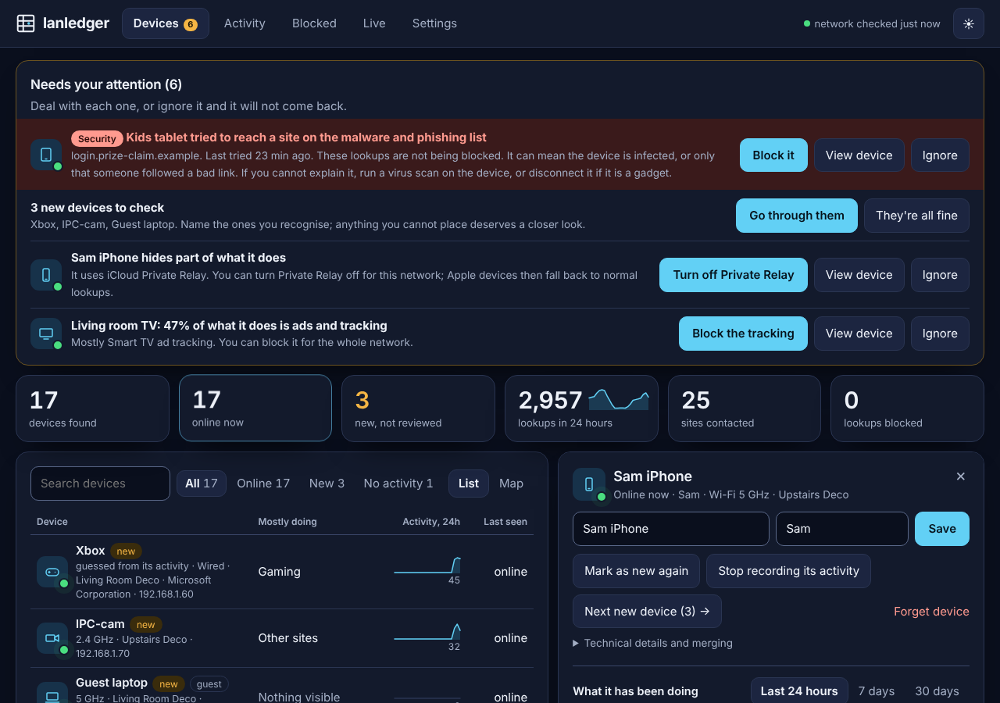
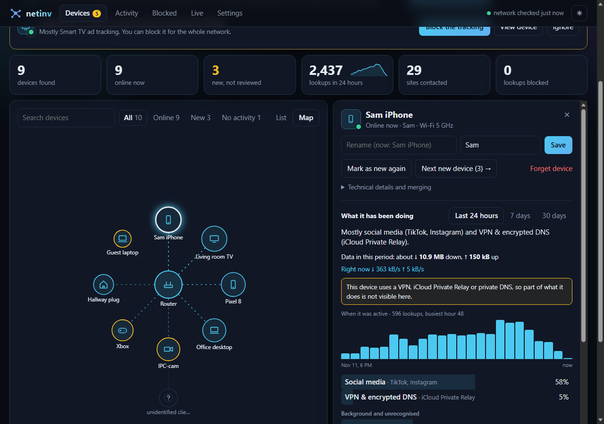
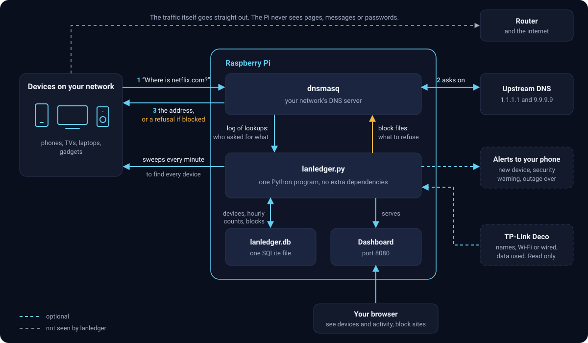

# lanledger

**See every device on your home network, what each one is doing, and do something about it.** Runs on a Raspberry Pi.



lanledger answers three questions most routers leave you guessing about:

- **What is on my network?** Every device, named where possible, with new arrivals flagged for you to check.
- **What is each one doing?** Not a wall of server names, but "mostly streaming video (Netflix, YouTube)" or "44% of what it does is ad tracking".
- **What can I do about it?** Block a site or a whole service, on a schedule if you like. Switch on ready-made block lists. Get an alert when something new joins.

It is one Python program with no dependencies beyond what Raspberry Pi OS ships, one SQLite file, and a dashboard you open in a browser.



## What you get

**Devices**
- A full inventory, refreshed every minute, with a list view and a map view. With a mesh, the map groups devices by the unit each one connects through, which shows roughly where things are in the house. It zooms and pans, by mouse, touch or keyboard.
- Names from wherever they can be found: ones you type, your Deco app (optional), what devices announce about themselves, and your router.
- A best guess at anything unnamed ("Apple device", "Samsung TV", "Tuya-based smart plug"), clearly marked as a guess.
- A to-do list at the top of the page: security warnings first, then new devices, devices hiding their activity, devices that mostly talk to ad trackers, devices on your guest Wi-Fi.
- Per device: what it mostly does, when it was active, which sites it contacted, when it came and went, and which network services it leaves open.
- Say whose each device is and see activity per person. Merge a device's Wi-Fi and Ethernet entries into one.

**Security**
- Tells you which device tried to reach a site known for malware, phishing or controlling infected devices, whether or not you block those sites.
- Warns when something other than your router starts answering as your router, which is how traffic on a home network gets intercepted.
- See [what this can and cannot catch](#security-warnings).

**Blocking**
- Block any site from wherever you see it. Blocking a known service such as TikTok blocks all of its known addresses in one click.
- Block only during certain hours, such as 21:00 to 07:00.
- Ready-made lists you can switch on: malware and phishing; ads, trackers and malware; adult sites; gambling; social media; fake news. They update daily, and you can allow exceptions.

**Your connection**
- Is the internet up, how responsive is it, and when did it drop in the last week.
- A download speed test you can run from the dashboard.

**Extras**
- A password for the dashboard.
- Privacy controls: stop recording a device altogether, and keep device and site names out of alerts.
- Backup and restore in one command.
- Alerts to your phone when a new device joins, a security warning is raised, or the internet comes back after an outage.
- TP-Link Deco integration: device names from the Deco app, wired or Wi-Fi, guest network, and an estimate of data used per device.
- Works on a phone, and can be added to the home screen like an app.
- Download the inventory as a spreadsheet.

## How it works, in one paragraph

The Pi becomes your network's DNS server (using dnsmasq). Before any device can reach a site it has to ask for that site's address, so the Pi sees which device asked for what, and can refuse to answer for anything you block. Separately, lanledger sweeps the network every minute to find devices. That is all it relies on: it does not sit in the path of your traffic, and it cannot read pages, messages or passwords.



## What you need

- A Raspberry Pi (any model with networking) running Raspberry Pi OS or Debian, connected to your network, preferably by cable.
- A router that lets you change the DNS server it hands out. Most do. Some ISP-supplied routers do not; see [Limits](#limits).

## Install

On the Pi:

```
git clone https://github.com/nthnle/lanledger
cd lanledger
sudo ./install.sh
```

The installer sets up dnsmasq and lanledger as services and prints the dashboard address, `http://<pi-address>:8080`. The device inventory starts filling in straight away.

Then two changes on your router, so the Pi sees lookups:

1. **Reserve the Pi's address** (DHCP reservation), so it never changes.
2. **Set the DNS server your router hands out to the Pi's address**, and only that one.

Devices pick up the new setting as they reconnect, which can take up to a day. Turning a device's Wi-Fi off and on speeds it up.

The first time you open the dashboard it asks you to choose a password. Do that straight away: until then, whoever opens it first gets to choose.

### Installer options

Set these in front of the command, for example `sudo ENCRYPTED_DNS=1 ./install.sh`.

| Option | What it does | Default |
|---|---|---|
| `IFACE` | Network interface to use, such as `eth0` | detected |
| `GATEWAY` | Your router's address | detected |
| `PORT` | Dashboard port | `8080` |
| `UPSTREAM1`, `UPSTREAM2` | Where lookups are forwarded | `1.1.1.1`, `9.9.9.9` |
| `ENCRYPTED_DNS=1` | Forward lookups encrypted (DNS-over-HTTPS through dnscrypt-proxy), so your internet provider cannot read them. Falls back to the plain upstreams if it does not come up. | off |
| `NOTIFY_URL` | Where to send alerts. Easier to set later in Settings. | none |
| `EXTRA_ARGS` | Anything else to pass to lanledger, for settings the installer has no name for. For example `EXTRA_ARGS="--retention-days 14"` keeps two weeks of history instead of 30 days, and `--no-threat-list` or `--oui-url ""` switch off those downloads. | none |

### Updating

```
cd lanledger
./update.sh
```

That fetches the latest version and reinstalls it. Your data is kept, and so are the installer options you used before: they are remembered in `/etc/lanledger/install.conf`. To change one, run the installer with it once, for example `sudo PORT=9090 ./install.sh`. To forget one, give it the value `default`, as in `sudo NOTIFY_URL=default ./install.sh`.

An update only restarts the DNS service when its settings changed, so most updates do not interrupt lookups. If dnsmasq refuses new settings, the installer puts the previous ones back and stops.

**Coming from netinv?** That was this project's name until it was renamed. Update as above: the installer finds the old install and moves everything over (history, device names, password, block lists), then removes the old service. You will be asked to sign in again. The dashboard address does not change.

If you installed before `update.sh` existed, run `git pull` and `sudo ./install.sh` (with your options) one last time.

### Backing up, and moving to a new card or Pi

Everything that cannot be fetched again is in one database: devices, names, history, blocks and the password. SD cards fail, so copy it somewhere else now and then:

```
sudo ./backup.sh                       # writes lanledger-backup-<date>.tar.gz here
sudo ./backup.sh --restore that-file.tar.gz
```

A backup is safe to take while lanledger runs. To move house, install lanledger on the new card or Pi first, then restore; what was there before the restore is kept beside it. The file holds your household's history, the password's hash, and the Deco password if you connected one, so store it with care.

## Using it

| Tab | What is there |
|---|---|
| **Devices** | The to-do list (security warnings first), the inventory (list or map), and everything about a device when you click it. |
| **Activity** | What the whole network did in the last 24 hours, internet health and speed, activity per person, and "who used this site?". |
| **Blocked** | What you have blocked and when, ready-made block lists, exceptions, and what was actually blocked today. |
| **Live** | Lookups as they happen, and a log of devices coming and going. |
| **Settings** | Password, Deco connection, alerts. |

A few things worth knowing:

- **Naming a device also marks it as reviewed.** "Go through them" walks you through everything new.
- **A block takes a few minutes to bite**, because devices remember addresses they already looked up.
- **Blocking is for the whole network.** lanledger cannot block a site for one device only.
- **If lanledger itself is in trouble**, the status at the top right turns red and says what: lookups not being recorded, or the network sweep finding nothing.
- **A device can be left out.** In its panel, **Stop recording its activity** erases what was recorded for it and keeps nothing more. It stays in the device list, blocks still apply, and a known-bad site is still reported.
- **"Lookups" are counts of address requests**, not time spent or data moved. The shares in "what it has been doing" are shares of lookups.

### Connecting a TP-Link Deco

In **Settings**, enter the address of your main Deco and the Deco owner password (your TP-Link ID password). lanledger only reads from the Deco.

Before you do:

- **It has to be the owner account**, and a Deco allows one owner session at a time. If you also use the Deco app as the owner, the app and lanledger will keep signing each other out. The usual fix is to add a manager account in the Deco app (More > Managers) and use that in the app.
- **The password is stored on the Pi** so lanledger can sign in again on its own. It is kept as it is, not scrambled, because lanledger has to send it to the Deco each time. Only the lanledger service and root on the Pi can read the file. Because it is your TP-Link ID password, make it one you use nowhere else.
- **Data-used figures are estimates**, worked out from the speeds the Deco reports every 30 seconds.
- You can test the connection by hand first: `python3 deco.py http://<deco-address>`.

The Deco integration follows the protocol used by the [Home Assistant Deco integration](https://github.com/amosyuen/ha-tplink-deco). It runs against a real five-unit Deco mesh, and the tests check it against a pretend Deco that verifies the encryption. Reports from other models and firmware, working or not, are welcome.

### Security warnings

Two checks run all the time and put a red entry at the top of the to-do list. If alerts are set up, they also reach your phone.

**A device tried to reach a known-bad site.** lanledger keeps a list of sites known for malware, phishing and controlling infected devices, refreshed daily, and compares every lookup against it. A match names the device and the site. This happens whether or not the list is switched on for blocking: watching is always on, blocking is your choice (the **Malware and phishing** list on the Blocked tab, or **Block them** on the warning itself).

- It usually means one of two things: the device is infected, or someone followed a bad link. A single hit from a phone or computer is often the second. Repeated hits, or any hit from a gadget nobody browses on, deserve a virus scan or unplugging the gadget.
- Lists are sometimes wrong. If a site you trust is flagged, add it under **Exceptions** on the Blocked tab and it will not be reported again.
- **Ignore** silences the warning for what the device has tried so far. If it tries a listed site it had not tried before, the warning comes back.

**Something is answering as your router.** Every sweep, lanledger checks which hardware answers for the router's address, and which hardware the Pi itself has been told is the router. If a device that is not part of your router or mesh shows up there twice in a row, you are warned.

- If you have just replaced the router or the main mesh unit, this is expected: press **This is fine** and that hardware is trusted from then on.
- Otherwise find the device (the warning gives its hardware address and, if known, its name) and disconnect it if you cannot explain it.

What these do not catch: connections made straight to a numeric address with no lookup, anything from a device that bypasses the Pi (see [Limits](#limits)), and an impostor that only fools other devices while staying quiet towards the Pi. Treat them as an early warning, not as proof that the network is clean.

Switching the list on blocks each listed site and everything under it, so `login.bad.example` is refused when `bad.example` is listed. That needs dnsmasq 2.86 or newer, which Raspberry Pi OS has shipped since 2023; on an older one lanledger falls back to blocking the exact names on the list.

To switch the known-bad site check off entirely, reinstall with `sudo EXTRA_ARGS="--no-threat-list" ./install.sh`.

### Alerts

lanledger can send a line of text to any address that accepts one. The simplest setup is the free [ntfy](https://ntfy.sh) app: subscribe to a topic name you make up, then put `https://ntfy.sh/<that-name>` in Settings. Anyone who knows the topic name can read the alerts, so make it hard to guess.

## Limits

Be clear-eyed about what a DNS-based tool can and cannot do.

- **It sees names, not content.** Which sites, how often, and when. Never pages, messages or how much data moved (except the Deco estimate).
- **Some devices bypass it.** Anything using a VPN, iCloud Private Relay, a browser with its own encrypted DNS, or a hard-coded DNS server (some smart TVs and streaming sticks) shows little or nothing. lanledger flags these when it can tell, and can switch Private Relay off for your network.
- **The same goes for blocking.** A device that bypasses the Pi's DNS is not affected by blocks.
- **Guesses are guesses.** Device types and activity categories come from a built-in list of well-known services in `lanledger.py`. Anything not on it shows as "Other sites".
- **Phones use private hardware addresses.** A phone that rotates its address shows up as a new device each time.
- **"Online" is approximate.** A sleeping phone often does not answer the sweep. Connecting a Deco makes this more accurate.
- **Isolated devices are out of reach.** A device you put in Device Isolation in the Deco app cannot talk to the Pi, so lanledger sees none of its lookups and cannot block anything for it. With a Deco connected, lanledger marks such devices "isolated" and stops warning that they are silent. It works this out from the Deco calling a device online while the Pi cannot reach it, so treat the label as a strong hint.
- **The Pi becomes a dependency.** If it is off, nothing on your network can look up addresses. Adding a second DNS server on the router avoids that, but lets devices skip lanledger whenever they like.
- **IPv6.** If your provider gives you IPv6, your router may advertise its own IPv6 DNS server alongside the Pi. Turn that off in the router if it has the setting.
- **Locked-down routers.** If yours will not let you change the DNS server, the workaround is to turn off its DHCP and let dnsmasq on the Pi do that job too. lanledger does not set this up for you.

## Security and privacy

- **The dashboard always has a password.** It asks you to choose one on first use, and shows nothing until you have. Five wrong tries lock out the device that made them, for longer each time.
- **The dashboard is plain HTTP.** The password stops casual access on your own network. It does not protect against someone capturing traffic on that network. Do not expose the dashboard to the internet.
- **Everything is stored on the Pi**, in `/var/lib/lanledger`. Activity is kept as hourly counts per device and site for 30 days (change it with `EXTRA_ARGS="--retention-days N"`). The DNS service's own log, which lists every lookup with the address that made it, is kept for today and yesterday.
- **One password sees everything.** Whoever can sign in sees every device's activity; there are no separate accounts. If that is too much for someone in the house, stop recording their devices (above), which also erases what was recorded.
- **Alerts go through someone else's service.** By default an alert names the device and, for a security warning, the site. Tick **Leave device and site names out of alerts** in Settings and an alert says only that something happened.
- **What leaves your network**, and only this:
  - Your DNS lookups, to the upstream servers, as with any DNS setup.
  - A connection check to `1.1.1.1` and `9.9.9.9` every minute.
  - Block lists you switch on, downloaded daily from GitHub.
  - The malware and phishing list, downloaded daily from GitHub whether or not you block with it, because it is what the security warnings check against. Nothing about your devices or lookups is sent: the comparison happens on the Pi. Turn it off with `EXTRA_ARGS="--no-threat-list"`.
  - The public register of hardware makers, downloaded about once a month from the IEEE, so devices show who made them. Nothing about your devices is sent. Turn it off with `EXTRA_ARGS='--oui-url ""'`.
  - A speed test download from Cloudflare, when you press the button.
  - Alerts, to the address you configure, if you configure one.
- **Forgot the dashboard password?** On the Pi: `sudo -u lanledger python3 /opt/lanledger/lanledger.py --reset-password`, then open the dashboard and choose a new one. This also removes the stored Deco password.

**Use it on your own network, and be straight with the people on it.** lanledger shows which sites each device contacts. Tell the people you live with that it is running.

## Under the hood

| Path | What |
|---|---|
| `/opt/lanledger/` | `lanledger.py` (everything), `deco.py` (Deco client), `dashboard.html` |
| `/var/lib/lanledger/lanledger.db` | All data |
| `/var/lib/lanledger/oui.tsv` | Who makes which hardware addresses, refreshed monthly |
| `/etc/lanledger/install.conf` | The installer options you gave, remembered for updates |
| `/var/lib/lanledger-dns/` | Block files that lanledger writes and dnsmasq reads |
| `/var/log/lanledger/dnsmasq.log` | Raw lookups, rotated daily, yesterday's kept |
| `/etc/dnsmasq.d/lanledger.conf` | dnsmasq settings |
| `/etc/systemd/system/lanledger*.{service,path}` | The service, and a watcher that makes dnsmasq re-read the block files |

lanledger runs as its own unprivileged user. Its only extra privilege is sending the raw packets the network sweep needs.

```
systemctl status lanledger dnsmasq
journalctl -u lanledger -f
```

**Uninstall:** set your router's DNS setting back first, then:

```
sudo systemctl disable --now lanledger lanledger-blocklist.path dnsmasq
sudo rm -rf /opt/lanledger /etc/lanledger /var/lib/lanledger /var/lib/lanledger-dns /var/log/lanledger \
  /etc/dnsmasq.d/lanledger.conf /etc/logrotate.d/lanledger /etc/systemd/system/lanledger*
```

**Tests:** `python3 -m unittest discover tests` and `node tests/test_dashboard.js`. They need nothing installed and do not touch the network: the web server, the DNS log reader and the Deco client are each run against stand-ins on this machine.

## Status

This is a personal project that works for a home network. The core (inventory, activity, blocking, dashboard) runs on a real Pi. It has run for its author on a Pi 4 with a five-unit Deco mesh and about 57 devices. Less proven: other routers and Deco models, the security warnings (new, and built to stay quiet rather than cry wolf), and `ENCRYPTED_DNS=1`, which has not been tried across Pi OS versions. If something does not work for you, open an issue with the output of `journalctl -u lanledger -n 50`.

## Licence

[MIT](LICENSE). The block lists and the maker register that lanledger downloads belong to their own projects and come under their own terms; none of them is included here.

## Credits

- Block lists: [Steven Black's hosts project](https://github.com/StevenBlack/hosts).
- Malware and phishing list: the Threat Intelligence Feeds (mini) from [HaGeZi's DNS blocklists](https://github.com/hagezi/dns-blocklists).
- Deco protocol: [ha-tplink-deco](https://github.com/amosyuen/ha-tplink-deco) by amosyuen.
- Alerts work nicely with [ntfy](https://ntfy.sh).
- DNS by [dnsmasq](https://thekelleys.org.uk/dnsmasq/doc.html), discovery by [arp-scan](https://github.com/royhills/arp-scan).
